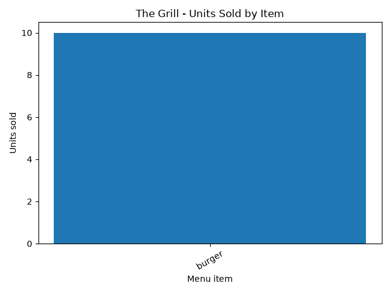
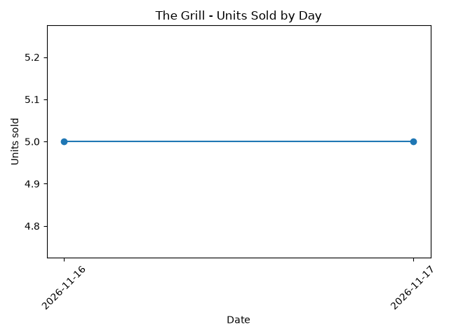

# The Grill — Restaurant Sales & Inventory Manager

## Business Problem
The Grill tracks menu item inventory and sales by hand. This app lets
the manager restock items, record sales, and keep stock counts and
sales records between runs.

## Business Question
At what stock level should we reorder each menu item so we rarely run out?

## How to Run
1. Open the project folder in VS Code.
2. Choose Terminal → New Terminal.
3. Run `py main.py` on Windows, or `python main.py` if that is your Python command.
4. Choose a numbered menu option and follow the prompts.
5. Choose option 7 to save inventory and sales before closing the app.
Install matplotlib once using `py -m pip install matplotlib`.

## Menu Options
1. View inventory
2. Add or restock an item
3. Record a sale
4. Show low-stock alerts — coming soon
5. Sales report
6. Run 30-day simulation — coming soon
7. Save and exit
8. Show sales charts

## Files
- `main.py` — displays the menu and calls the other modules.
- `inventory.py` — loads, saves, displays, and updates inventory and records sales.
- `reports.py` — groups sales data and creates the text report and charts.
- `inventory.csv` — stores menu item prices, stock, and reorder levels.
- `sales.csv` — stores recorded sales.
- `units_by_item.png` — bar chart showing units sold by menu item.
- `units_by_day.png` — line chart showing units sold by recorded date.

## Charts

This chart identifies the items with the most recorded sales, helping
the manager decide which items need closer inventory monitoring.

This chart shows changes in sales volume across recorded dates, helping
the manager plan stock for busier periods.

## Author
Briston Flug
